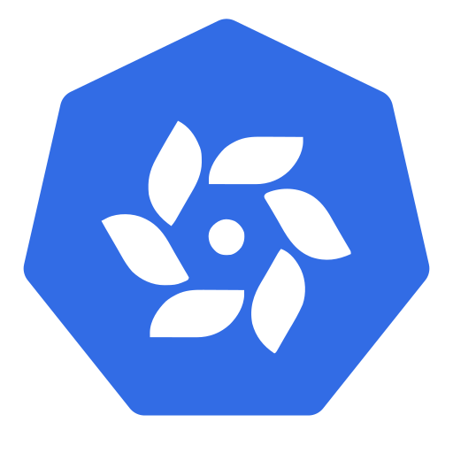

  

<h2 align="center">oxia-k8s</h2>

Run Kubernetes on <a href="https://github.com/oxia-db/oxia">Oxia</a>: the cluster keeps its state in Oxia,
through the <a href="https://github.com/oxia-db/oxia-etcd">oxia-etcd</a> gateway, instead of etcd.

## Labs

| Lab | What it runs |
|---|---|
| [k3s](labs/k3s) | On one machine with Docker Compose: an Oxia cluster with Raft coordinators, two oxia-etcd gateways, and k3s on them |

## Contributors

